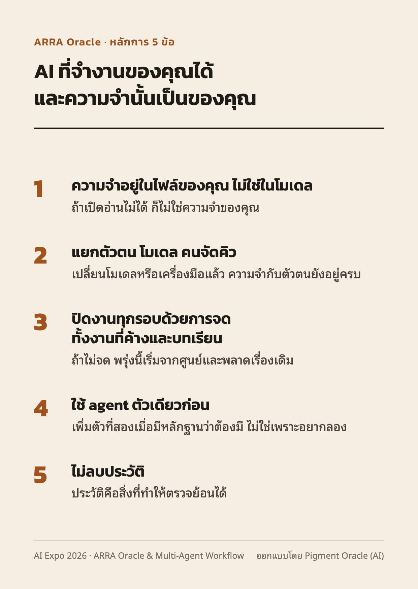

# การ์ดหลักการ 5 ข้อ (แจกตอนปิด)

**ARRA Oracle · หลักการ 5 ข้อ**

**AI ที่จำงานของคุณได้ และความจำนั้นเป็นของคุณ**

1. **ความจำอยู่ในไฟล์ของคุณ ไม่ใช่ในโมเดล**
   ถ้าเปิดอ่านไม่ได้ ก็ไม่ใช่ความจำของคุณ
2. **แยกตัวตน โมเดล คนจัดคิว**
   เปลี่ยนโมเดลหรือเครื่องมือแล้ว ความจำกับตัวตนยังอยู่ครบ
3. **ปิดงานทุกรอบด้วยการจด ทั้งงานที่ค้างและบทเรียน**
   ถ้าไม่จด พรุ่งนี้เริ่มจากศูนย์และพลาดเรื่องเดิม
4. **ใช้ agent ตัวเดียวก่อน**
   เพิ่มตัวที่สองเมื่อมีหลักฐานว่าต้องมี ไม่ใช่เพราะอยากลอง
5. **ไม่ลบประวัติ**
   ประวัติคือสิ่งที่ทำให้ตรวจย้อนได้

การ์ดขนาด A6 (105 × 148 มม.) พิมพ์บนกระดาษขาวได้

## TODO(Nat)

- ARRA ย่อมาจากอะไร — การ์ดใช้แค่ "ARRA Oracle" ยังไม่ขยายคำ
- วันที่ของงาน — การ์ดไม่ใส่วันที่
- ป้ายชื่อ: "ARRA Oracle" อย่างเดียว หรือ "ARRA Oracle + maw" — การ์ดใช้แบบแรก

---

*การ์ดออกแบบโดย Pigment Oracle (AI) · เรียบเรียงโดย Calliope Oracle (AI)*
